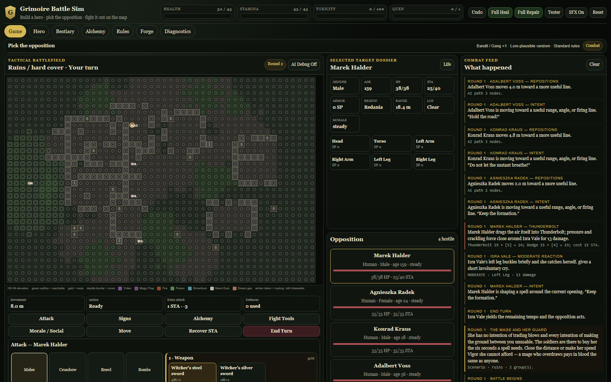
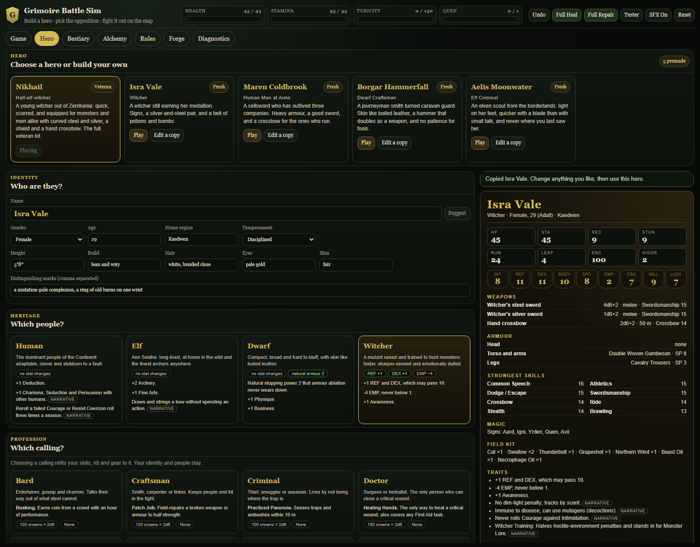
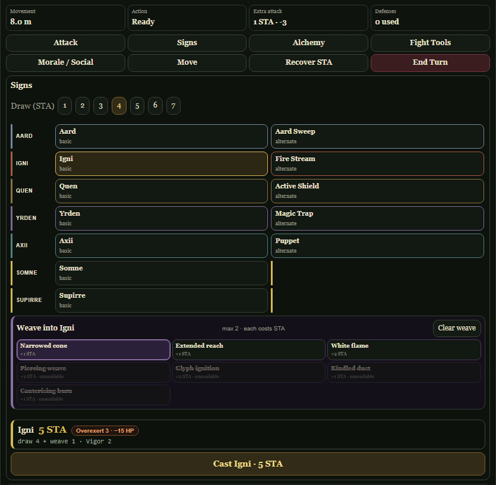

# Grimoire Battle Sim

[](LICENSE)

A tabletop-style tactical battle simulator. Build a hero, pick the opposition, and fight it out on a
living map. It runs entirely in your browser, with no server and no account, and it is built to be
played alone, run as a sandbox, or used to test a character before bringing it to a real table.



## What it does

- **Build a hero.** A full character creator: choose a people and a calling, spend a point pool or roll
  the dice, buy skills and gear, and export the result as text. Five premade heroes are ready to play,
  and four can be opened as a copy to edit. [More](docs/PLAYING.md#building-a-hero)
- **Fight on a real map.** A 48 x 32 metre field at one metre a tile, with rivers, boulders, ruins,
  marsh, ice, darkness, elevation and cover that change what you can do. Seventeen battlefields are
  generated fresh each fight.
- **Weave your magic.** Cast Signs with a chosen draw of Stamina and weave in augments. The cost
  readout shows exactly what the cast will spend, including the Health you would burn past your Vigor
  Threshold, before you commit the action.
- **Face things that fight like themselves.** Sixty-three creatures with their own abilities and
  weaknesses, driven by a utility-scoring AI with cognition tiers: a drowner closes and bites, a
  griffin charges from range, a mage keeps its distance and opens with its heaviest spell.
- **Play set pieces.** Ten authored scenarios, each with a briefing written to be read aloud, from a
  roadside toll to a wyvern on a mountain pass.
- **Bring your own.** Characters, scenarios and Sign augments load as validated JSON content packs, so
  new material goes through one path and never overwrites what ships.
- **See the arithmetic.** Every roll in the combat feed carries the maths behind it. The dice are
  seeded and the simulation is deterministic, which is what makes tests and bug reports reproducible.

<table>
  <tr>
    <td width="50%"></td>
    <td width="50%"></td>
  </tr>
  <tr>
    <td align="center"><sub>The hero creator, with a live sheet that says what is still wrong</sub></td>
    <td align="center"><sub>Signs, weaving and the cost readout</sub></td>
  </tr>
</table>

## Quick start

You need [Node.js](https://nodejs.org/) 22 or newer.

```bash
git clone https://github.com/Nyrquellts/grimoire-battle-sim.git
cd grimoire-battle-sim
npm install
npm run dev
```

Open the address Vite prints (by default <http://localhost:5173>). Start on the **Hero** tab to seat a
hero, then pick a foe on the **Game** tab or run a set piece from the **Forge** tab.
[docs/PLAYING.md](docs/PLAYING.md) says where everything is.

| Command | What it does |
| --- | --- |
| `npm run dev` | Dev server with hot reload |
| `npm run build` | Production bundle in `dist/` |
| `npm run typecheck` | Strict TypeScript, no emit |
| `npm test` | The Vitest suite (Node, no DOM needed) |
| `npm run ci` | Everything CI runs: kernel audit, typecheck, tests, build |
| `npm run metrics` | Size of the legacy bridges, which are only allowed to shrink |

## How it is built

The simulation is a pure kernel with no browser dependencies, and every change to the game goes
through one action gateway that validates, spends, resolves and can roll back exactly. Presentation
only asks for actions; it never owns combat truth.

| Path | Role |
| --- | --- |
| `src/core` | State, deterministic RNG and dice, the action gateway, events |
| `src/entities` | The strict public types and actor helpers |
| `src/data` | The content registry, rule data, schemas and content packs |
| `src/services` | Rules services, AI, grid and pathfinding, the hero builder |
| `src/actions` | One module per action family, registered on the gateway |
| `src/ui`, `src/adapters` | Panels that render to strings, effects and the DOM adapter |
| `tests` | Unit and integration tests, plus 168 named behaviour contracts |

Content is data. Every creature, weapon, Sign, scenario and battlefield is a registry row, so the
setting can be extended or swapped without touching engine code. Rule status travels with the content
(`standard`, `adapted`, `house` or `original`), so it is always clear what follows the reference rules
and what was added. See [ARCHITECTURE.md](ARCHITECTURE.md) and
[docs/CONTENT_POLICY.md](docs/CONTENT_POLICY.md).

TypeScript 7 (strict, with `noUncheckedIndexedAccess`), Vite 8, Vitest 4, Zod 4 and Zustand 5.

## Project status

The simulator is playable end to end: heroes, ten scenarios, the Signs system, bombs, creature
abilities, zones and content packs all run. The numbers, what was checked in a real browser, and what
has not been measured are in [docs/STATUS.md](docs/STATUS.md); open defects and gaps are in
[docs/KNOWN_ISSUES.md](docs/KNOWN_ISSUES.md).

Not included, by design or for now: save games (export a hero or a pack as JSON instead),
multiplayer, and a battle view tuned for phones.

## Documentation

[docs/INDEX.md](docs/INDEX.md) has the full map. The short list:

- [Playing](docs/PLAYING.md) - the interface, Signs, bombs, authoring
- [Architecture](ARCHITECTURE.md) - module ownership and runtime flow
- [Contributing](CONTRIBUTING.md) - ground rules and how to add content
- [Status](docs/STATUS.md) and [Known issues](docs/KNOWN_ISSUES.md)
- [Decisions](docs/DECISIONS.md) and [History](docs/HISTORY.md) - why it looks the way it does

## Notice

Grimoire Battle Sim is an unofficial, non-commercial fan project. It is not affiliated with or
endorsed by any publisher, author or rights holder, and it contains no rulebook text, artwork or
other publisher-created expression. [NOTICE.md](NOTICE.md) explains what is in the repository and
what is not.

## License

The original work in this repository is released under the [MIT License](LICENSE). The license covers
this project's own code and writing and grants no rights in any third-party trademark or material.
